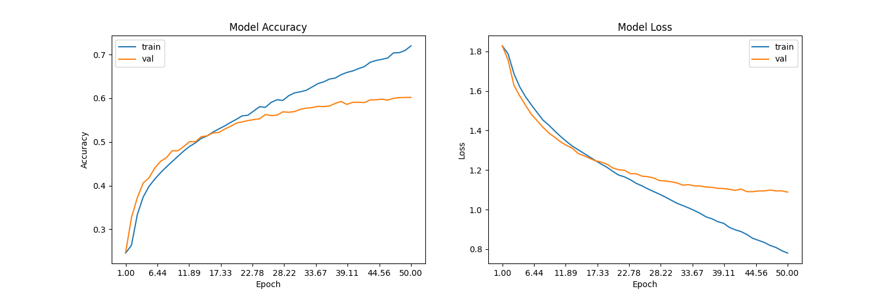

# Sentivision

**Real-Time Facial Emotion Recognition & Affective Vision Engine**

[](https://www.python.org/)
[](https://tensorflow.org/)
[](https://opencv.org/)
[](LICENSE)
[](https://github.com/<your-username>/sentivision/pulls)

Sentivision is a lightweight deep-learning engine designed to detect and classify facial expressions in real time. Built with a 4-layer Convolutional Neural Network (CNN) and OpenCV, the engine provides low-latency affective telemetry from live video feeds, with a roadmap expanding toward **Zoom meeting integration**, **CCTV/RTSP stream monitoring**, and **engagement analytics**.

---

## Features

- **Real-Time Inference:** Fast face localization paired with low-latency CNN classification.
- **7 Core Affective States:** Classifies facial expressions into:
  - *Angry, Disgusted, Fearful, Happy, Neutral, Sad, Surprised*
- **Trained on FER-2013:** Benchmark-trained on 35,000+ labeled facial images.
- **Stream Extensibility:** Designed to integrate with local webcams, RTSP IP cameras, and virtual meeting video devices.

---

## Model Performance & Evaluation

The CNN was evaluated on the FER-2013 validation set across 50 epochs using the Adam optimizer:

<div align="center">
  
</div>

- **Baseline Validation Accuracy:** ~60.3% across all 7 emotion classes.
- **Open Challenge:** We are actively looking for contributors to help push baseline accuracy beyond 68%+ using learning rate scheduling, data augmentation, or lightweight modern backbones (e.g., MobileNetV3 / Vision Transformers).

---

## Quickstart

### 1. Installation

```bash
# Clone the repository
git clone https://github.com/<your-username>/sentivision.git
cd sentivision

# Set up a virtual environment
python -m venv venv
# Windows:
venv\Scripts\activate
# Linux / macOS:
source venv/bin/activate

# Install dependencies
pip install tensorflow opencv-python matplotlib numpy
```

### 2. Live Webcam Inference

Run live inference immediately using the bundled pre-trained weights (`model.h5`):

```bash
cd src
python emotion_recognition.py --mode display
```
*Press `q` to exit the video stream.*

---

## Dataset Setup (Optional for Retraining)

The raw dataset images are excluded from Git to keep the repository lightweight. If you plan to train the model from scratch:

1. Download the pre-split dataset from [Kaggle FER-2013 (by msambare)](https://www.kaggle.com/datasets/msambare/fer2013):
   ```bash
   kaggle datasets download -d msambare/fer2013
   ```
2. Extract the archive into `src/data/`:
   ```
   src/data/
   ├── train/
   │   ├── angry/
   │   ├── disgust/
   │   └── ...
   └── test/
       ├── angry/
       └── ...
   ```
3. Run training:
   ```bash
   cd src
   python emotion_recognition.py --mode train
   ```

---

## Project Structure

```
sentivision/
├── .gitignore                      # Ignores dataset, virtualenvs, caches, and checkpoints
├── README.md                       # Documentation & benchmarks
└── src/
    ├── emotion_recognition.py      # Core training and inference pipeline
    ├── haarcascade_frontalface_default.xml # Haar Cascade face detector
    ├── model.h5                    # Pre-trained CNN weights
    └── plot.png                    # Training accuracy and loss curves
```

---

## Roadmap

- [ ] **Zoom / Teams Virtual Camera:** Output live emotion HUD directly into video calls via `pyvirtualcam`.
- [ ] **CCTV / RTSP Stream Ingester:** Multi-threaded client to process live security camera feeds without lag.
- [ ] **Modern Face Detector:** Replace Haar Cascades with OpenCV YuNet or MediaPipe for multi-angle face detection.
- [ ] **Edge Optimization:** Convert model weights to ONNX / TensorRT for sub-millisecond inference.
- [ ] **Real-Time Analytics Dashboard:** Web-based telemetry HUD (Streamlit / FastAPI) tracking attention and sentiment.

---

## Contributing & Collaboration

**Contributions are warmly welcomed!** Whether you want to improve model accuracy, clean up code, or build a new integration, you're invited to collaborate.

### How to contribute:
1. Pick any item from the **Roadmap** or open an **[Issue](https://github.com/<your-username>/sentivision/issues)**.
2. Fork the repository and create your feature branch:
   ```bash
   git checkout -b feature/amazing-feature
   ```
3. Commit your changes:
   ```bash
   git commit -m "feat: add amazing feature"
   ```
4. Push to your branch and open a **Pull Request**.

---

## License

Distributed under the [MIT License](LICENSE).
